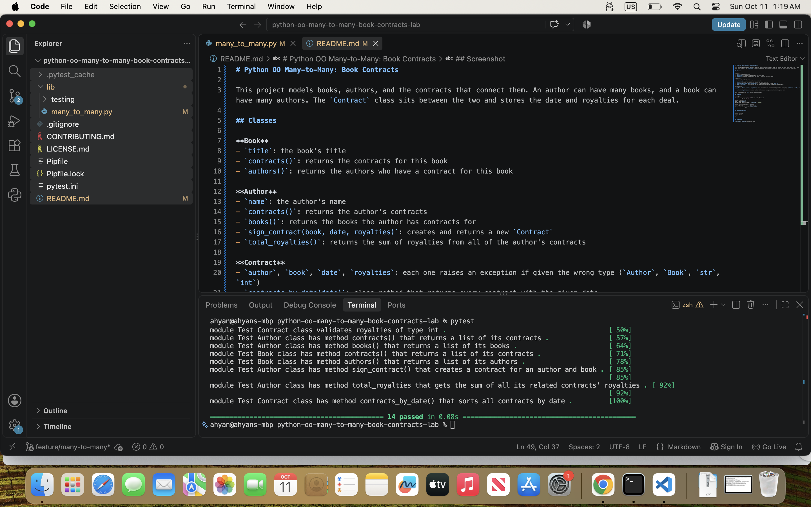

# Python OO Many-to-Many: Book Contracts

This project models books, authors, and the contracts that connect them. An author can have many books, and a book can have many authors. The `Contract` class sits between the two and stores the date and royalties for each deal.

## Classes

**Book**
- `title`: the book's title
- `contracts()`: returns the contracts for this book
- `authors()`: returns the authors who have a contract for this book

**Author**
- `name`: the author's name
- `contracts()`: returns the author's contracts
- `books()`: returns the books the author has contracts for
- `sign_contract(book, date, royalties)`: creates and returns a new `Contract`
- `total_royalties()`: returns the sum of royalties from all of the author's contracts

**Contract**
- `author`, `book`, `date`, `royalties`: each one raises an exception if given the wrong type (`Author`, `Book`, `str`, `int`)
- `contracts_by_date(date)`: class method that returns every contract with the given date

Each class keeps an `all` list of its instances.

## Example

```python
from lib.many_to_many import Author, Book, Contract

author = Author("Ann")
book = Book("Dune")
author.sign_contract(book, "01/01/2001", 60000)

author.total_royalties()   # 60000
book.authors()             # [author]
Contract.contracts_by_date("01/01/2001")
```

## Running the tests

```
pipenv install
pipenv shell
pytest
```

## Screenshot

